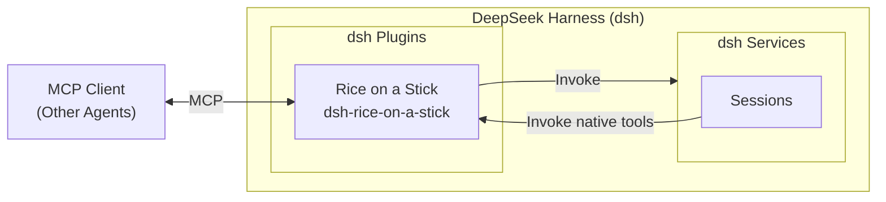

<div align="center">
  

# Rice on a Stick

[中文](README.md) | English

[](https://github.com/deepseek-ai/deepseek-harness)
[](https://github.com/Leawind/dsh-rice-on-a-stick/releases)
[](https://github.com/Leawind/dsh-rice-on-a-stick/commits/main)

A dsh plugin that exposes control over [DeepSeek Harness](https://github.com/deepseek-ai/deepseek-harness) as MCP and built-in tools.

</div>



## Features

- **Operate sessions** — create, send, queue, fork, archive and restore, switch models, and more. The "Models" tab of the sidebar page can be limited to specific models, so clients can only use the ones ticked; blurbs for models and their providers can be written there and are surfaced through `model_list` / `dsh://models` for callers.
- **Answer like a normal Web user** — the plugin joins as a Web answer client for approvals and `ask_user_question`: the native cards stay visible and whoever answers first wins. Polling surfaces what is pending, and `approval_answer` / `question_answer` submit the decision.
- **dsh endpoint passthrough** — low-curation coverage for the long tail of dsh capabilities. Dangerous endpoints (credential writes, plugin installs, connection trust) have no hard gate: they take the same allowlist/parking paths as ordinary endpoints but are listed separately with a warning on the panel; see `CONTRIBUTING.md` and `docs/endpoint-passthrough.zh.md`.
- **dsh can use it too** — these capabilities are also registered as internal dsh tools, callable directly from dsh sessions; they can be disabled in settings if not needed.
- **Secure by default** — listens only on localhost by default, with an optional access token.

> [!WARNING]
>
> - When authentication is not enabled, any local process that can reach the corresponding port can drive dsh.
> - This plugin exposes local code execution capability to callers, and listens only on `127.0.0.1` by default.
> - Once the internal self-use tools are enabled, any session of this dsh instance can call them, because they do not go through HTTP and are unrelated to the token.

## Requirements

- dsh `0.2.1-rc.2` or later. The graphical interface (the "Rice on a Stick" page in the sidebar) and full session functionality require the web or desktop version of dsh
- MCP clients must support Streamable HTTP; clients that only support stdio need to bridge it themselves

## Installation

Install via npm:

```sh
dsh plugin --profile web add dsh-rice-on-a-stick
```

Install from source with live updates:

```sh
git clone https://github.com/Leawind/dsh-rice-on-a-stick
cd dsh-rice-on-a-stick
npm install
npm run build
dsh plugin --profile web add link:.

# Watch source changes and rebuild live
npm run dev
```

Uninstall:

```sh
dsh plugin --profile web remove dsh-rice-on-a-stick
```

### Connecting an MCP Client

The MCP server listens on `http://127.0.0.1:5642/mcp` by default, using Streamable HTTP transport; after enabling authentication in settings, Bearer credentials must be configured.

## Configuration

All configuration can be changed in the "Rice on a Stick" page (Security tab) of the dsh sidebar; the MCP connection idle limit lives on the Connections tab. For all fields, defaults, and descriptions of `cordis.patch.yml` in the profile directory, see [src/core/config.ts](src/core/config.ts):

## Tools

The table below lists every MCP tool the plugin registers, grouped by domain.

### Catalog and status

| Tool              | Purpose                                                                                                                                        |
| ----------------- | ---------------------------------------------------------------------------------------------------------------------------------------------- |
| `echo`            | Echo the input back to verify MCP connectivity                                                                                                 |
| `dsh_get_started` | dsh onboarding guide: glossary, workflow recipes and an error→alternative-path cheat sheet; `section` fetches just one part                    |
| `dsh_list_tools`  | List the host's global tool registry (model tools live in session/preset scopes, so this table is usually empty)                               |
| `dsh_status`      | Read-only deployment status: version, listener, config summary, subscription stats and connected clients — the same data as the settings panel |
| `workspace_list`  | List registered workspaces (id, path, owning sessions)                                                                                         |
| `model_list`      | List routable providers, model ids, reasoning efforts, the preset roster and the host's current default selection                              |
| `permission_list` | List the host's permission presets (sandbox + approval bundles) — the values taken by `session_create.permission` / `session_set_permission`   |
| `subagent_list`   | Read a session's native subagent catalog; `recursive=true` lists descendants                                                                   |

### Session actions

| Tool                     | Purpose                                                                                                                                                            |
| ------------------------ | ------------------------------------------------------------------------------------------------------------------------------------------------------------------ |
| `session_create`         | Create a blank session with `cwd`, provider/model and preset all explicit; returns `sessionId`                                                                     |
| `session_set_permission` | Switch a session's permission preset (the server side of the UI's `/permission`), fixing knob-level `custom` combinations                                          |
| `session_prompt`         | Send a message and wait for the turn to finish, returning the structured result; by default it returns early while the session waits for an approval or a question |
| `session_submit`         | Admit a task asynchronously and return `requestId` immediately, without waiting for the turn                                                                       |
| `session_poll`           | Observe many sessions at once; `waitMs` waits up to 30s and reports states, queue lengths, pending answers and the last message                                    |
| `session_result`         | Fetch the structured result by `requestId` (omitting it returns the session's latest request)                                                                      |
| `session_cancel`         | Stop the session's current turn, keeping queued messages that have not started                                                                                     |
| `session_queue`          | Manage queued messages — list, edit, remove, or promote one to a steer with `action="steer"`                                                                       |
| `session_select_model`   | Switch a session's model in place, effective on the next step with history preserved (with "Only allow specific models" on, the target must be on the list)        |
| `session_rename`         | Rename a session through the host `sessionTitle` service (a user rename pins the auto-generated title)                                                             |
| `session_fork`           | Fork a session from a prefix of its events, inheriting cwd, preset and current model                                                                               |
| `session_command`        | List or run a session's slash commands without sending them to the model or creating a turn                                                                        |
| `session_archive`        | Archive a session (the UI's only delete, a soft mark); an active session requires `stopActivity=true`                                                              |
| `session_unarchive`      | Restore an archived session; idempotent, and a session that was not archived reports `wasArchived: false`                                                          |

### Session reads

| Tool               | Purpose                                                                                                                    |
| ------------------ | -------------------------------------------------------------------------------------------------------------------------- |
| `session_list`     | List session metadata (title, cwd, preset, permission preset, current model), hiding archived ones by default              |
| `session_history`  | Read a session's conversation digest (user + assistant by default; `roles` opts into tool calls), paged with `beforeIndex` |
| `session_meta`     | Read one session's metadata and runtime state: turn/step counters, context occupancy, and more                             |
| `session_overview` | One-call GUI-style glance: title, permission, model, in-progress state, context occupancy and a recent digest              |
| `session_search`   | Search session content by literal phrase (same as the UI search box), excluding archived sessions by default               |

### Approvals

| Tool              | Purpose                                                                                 |
| ----------------- | --------------------------------------------------------------------------------------- |
| `approval_list`   | List pending approvals for several sessions (with `answerable` and `policy`); read-only |
| `approval_answer` | Answer an approval this plugin holds: `allow` grants once, `reject` denies              |
| `approval_policy` | Read or switch a session's approval policy knob (`ask` / `never`)                       |

### Questions

| Tool              | Purpose                                                                                          |
| ----------------- | ------------------------------------------------------------------------------------------------ |
| `question_list`   | List pending `ask_user_question` calls for several sessions (with the question batch); read-only |
| `question_answer` | Answer a question batch this plugin holds; the child turn continues with that answer             |

### Attachments

| Tool              | Purpose                                                                                                                       |
| ----------------- | ----------------------------------------------------------------------------------------------------------------------------- |
| `attachment_read` | Read an image attachment by reference: metadata plus the host-local path by default, or an MCP image block with `inline=true` |

### Host endpoint passthrough

These two tools cover the long tail of dsh Remote endpoints; the endpoints themselves are not enumerated because their number follows the host (see [docs/endpoint-passthrough.zh.md](docs/endpoint-passthrough.zh.md) for the mechanism).

| Tool                | Purpose                                                                                                                                                                                                                                                                                             |
| ------------------- | --------------------------------------------------------------------------------------------------------------------------------------------------------------------------------------------------------------------------------------------------------------------------------------------------- |
| `endpoint_describe` | Discover dsh Remote endpoints, search first: `query` keyword search (optionally scoped by `namespace`), no arguments for the namespace index, `namespace` for one domain's methods, `endpoint` for the exact contract; entries are flagged `readOnly` / `allowed` / `writable` / `approvalRequired` |
| `endpoint_call`     | Invoke an endpoint from `endpoint_describe` with its named wire `args`; allowlisted endpoints execute directly, every other non-stream endpoint parks for a human decision, and decline, timeout or caller disconnect fails closed with nothing executed                                            |

## Delivery: queue vs. steer

`session_prompt` and `session_submit` choose the delivery mode per call, independent of any UI preference. While the target session is running a turn, `mode` is required:

- `mode: "queue"` — queued: delivered as a new turn after the current turn ends
- `mode: "steer"` — steered: injected at the next step boundary inside the current turn, extending it; a running step is never interrupted
- Omitting `mode` works only while the session is idle, where queue and steer are identical and the engine assumes queue; on a running session the call fails with `MODE_REQUIRED` — the plugin never guesses on the caller's behalf
- If messages are already queued, promote one to a steer with `session_queue`'s `action: "steer"`

## Acknowledgements

The initial source code was copied from [`chushixixin/dsh-harness-mcp-server`](https://github.com/chushixixin/dsh-harness-mcp-server) (MIT, thanks to @chushixixin).
