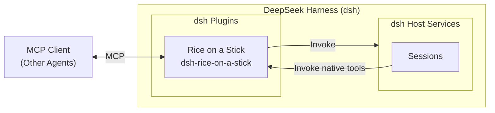

<div align="center">
  

# Rice on a Stick

[中文](README.md) | English

[](https://github.com/deepseek-ai/deepseek-harness)
[](https://github.com/Leawind/dsh-rice-on-a-stick/releases)
[](https://github.com/Leawind/dsh-rice-on-a-stick/commits/main)

A dsh plugin that exposes control over [DeepSeek Harness](https://github.com/deepseek-ai/deepseek-harness) as MCP and built-in tools.

</div>



## Features

-   **Operate sessions** — create, send, queue, fork, archive and restore, switch models, and more. A model allowlist can be manually configured so that clients can only use models on the list.
-   **Generic bridge** — low-curation coverage for the long tail of host capabilities.
-   **dsh can use it too** — these capabilities are also registered as internal dsh tools, callable directly from dsh sessions; they can be disabled in settings if not needed.
-   **Secure by default** — listens only on localhost by default, with an optional access token.

> [!WARNING]
>
> -   When authentication is not enabled, any local process that can reach the corresponding port can drive dsh.
> -   This plugin exposes local code execution capability to callers, and listens only on `127.0.0.1` by default.
> -   Once the internal self-use tools are enabled, any session of this dsh instance can call them, because they do not go through HTTP and are unrelated to the token.

## Requirements

- dsh `0.2.1-rc.2` or later. The graphical interface (the "Rice on a Stick" page in the sidebar) and full session functionality require the web or desktop version of dsh
- MCP clients must support Streamable HTTP; clients that only support stdio need to bridge it themselves

## Installation

Install via npm:

```sh
dsh plugin --profile web add dsh-rice-on-a-stick
```

Install from source with live updates:

```sh
git clone https://github.com/Leawind/dsh-rice-on-a-stick
cd dsh-rice-on-a-stick
npm install
npm run build
dsh plugin --profile web add link:.

# Watch source changes and rebuild live
npm run dev
```

Uninstall:

```sh
dsh plugin --profile web remove dsh-rice-on-a-stick
```

### Connecting an MCP Client

The MCP server listens on `http://127.0.0.1:5642/mcp` by default, using Streamable HTTP transport; after enabling authentication in settings, Bearer credentials must be configured.

## Configuration

All configuration can be changed in the "Rice on a Stick" page (Settings tab) of the dsh sidebar. For all fields, defaults, and descriptions of `cordis.patch.yml` in the profile directory, see [src/core/config.ts](src/core/config.ts):

## Acknowledgements

The initial source code was copied from [`chushixixin/dsh-harness-mcp-server`](https://github.com/chushixixin/dsh-harness-mcp-server) (MIT, thanks to @chushixixin).
