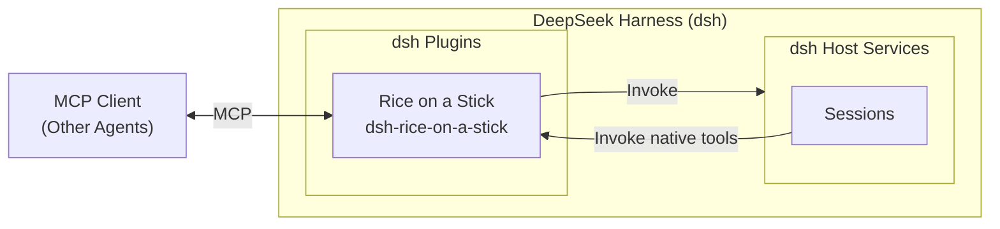

<div align="center">
  

# Rice on a Stick

[中文](README.md) | English

[](https://github.com/deepseek-ai/deepseek-harness)
[](https://github.com/Leawind/dsh-rice-on-a-stick/releases)
[](https://github.com/Leawind/dsh-rice-on-a-stick/commits/main)

A dsh plugin that exposes control over [DeepSeek Harness](https://github.com/deepseek-ai/deepseek-harness) as MCP and built-in tools.

</div>



## Features

-   **Operate real sessions** — create, send, queue, fork, archive and restore, switch models, and more.
    -   Creating a new session requires the calling agent to explicitly specify a model and preset.
    -   When continuing an existing session, the session's original model is retained.
    -   A model allowlist can be manually configured so that clients can only use models on the list.
    -   Permissions are expressed as presets (a sandbox mode + approval policy bundle, the same path as the UI's permission switcher and `/permission`): `permission_list` lists them, `session_create.permission` picks one for a new session, and `session_set_permission` switches an existing one; a knob-only approval change that matches no preset reads as `custom`.
    -   `session_overview` returns a GUI-style glance at a session in one call (title, permission, model + reasoning effort, in-progress state, context occupancy, recent content digest), with optional section selection; persisted-only sessions are readable too, and subscribing to `dsh://sessions/{id}/overview` pushes on turn boundaries.
-   **Image attachments, reference-only** — `session_prompt` / `session_submit` accept images (a host-readable local path or an http(s) URL): bytes are read inside the dsh process, admitted through the official attachment service, and delivered with the message; image data never enters tool arguments or the model context. Read them back with `attachment_read`: by default it returns metadata plus the host-local path (zero image tokens), and multimodal clients can opt into an inline MCP image block (billed as vision tokens, not base64 text).
-   **Generic bridge** — low-curation coverage for the long tail of host capabilities: `bridge_describe` resolves host Remote endpoints through a search-first ladder (`query` keyword search, no-args namespace index, `namespace` single-domain listing, `endpoint` exact contract), and `bridge_call` invokes endpoints by reference. Read-only by default (endpoints flagged `readOnly` in the dev-time endpoint metadata); mutating endpoints have two paths — allowlisted ones (`bridgeEndpointAllowlist`) execute directly, anything else parks the call until a human answers on the settings panel (decline / timeout / disconnect all fail closed). Dangerous endpoints (credential writes, plugin installs, connection trust) have no hard gate: they take the same two paths but are listed separately with a warning on the panel; see `CONTRIBUTING.md` and `docs/bridge-design.zh.md`.
-   **Synchronous or asynchronous** — the calling agent can wait for results in place, or submit and come back later; a wait timeout does not interrupt tasks running in dsh, and tasks can be stopped at any time.
-   **Approval takeover** — approval requests raised in sessions created by the plugin are answered by the calling agent by default, and are no longer shown again in the UI; this can also be changed to UI-first answering, or display-only without takeover.
-   **dsh can use it too** — these capabilities are also registered as internal dsh tools, callable directly from dsh sessions; they can be disabled in settings if not needed.
-   **Secure by default** — listens only on localhost by default, with an optional access token.

> [!WARNING]
>
> -   When authentication is not enabled, any local process that can reach the corresponding port can drive dsh.
> -   This plugin exposes local code execution capability to callers, and listens only on `127.0.0.1` by default.
> -   Once the internal self-use tools are enabled, any session of this dsh instance can call them, because they do not go through HTTP and are unrelated to the token.

## Requirements

dsh `0.2.1-rc.2` or later. The settings panel and full session functionality require the web or desktop version of dsh; MCP clients must support Streamable HTTP, and clients that only support stdio need to bridge it themselves.

## Installation

Install via npm:

```sh
dsh plugin --profile web add dsh-rice-on-a-stick
```

Install from source with live updates:

```sh
git clone https://github.com/Leawind/dsh-rice-on-a-stick
cd dsh-rice-on-a-stick
npm install
npm build
dsh plugin --profile web add link:.

# Watch source changes and rebuild live
npm run dev
```

Uninstall:

```sh
dsh plugin --profile web remove dsh-rice-on-a-stick
```

### Connecting an MCP Client

The MCP server listens on `http://127.0.0.1:5642/mcp` by default, using Streamable HTTP transport; after enabling authentication in settings, Bearer credentials must be configured.

## Configuration

All configuration can be changed in the graphical settings panel and takes effect on save — no plugin or host restart. Changing the listen address, the port, or whether the MCP service is provided rebuilds only the MCP listener: connected MCP clients must reconnect, while everything else (native tools, resource subscriptions, approvals) keeps running. You can also edit `cordis.patch.yml` in the profile directory directly (see [src/core/config.ts](src/core/config.ts) for all fields, defaults, and descriptions):

```yaml
- id: dsh-rice-on-a-stick
  config:
      http: true
      port: 5642
      host: 127.0.0.1
      # authToken: 'your-secret-token'
```

## Acknowledgements

The initial source code was copied from [`chushixixin/dsh-harness-mcp-server`](https://github.com/chushixixin/dsh-harness-mcp-server) (MIT, thanks to @chushixixin), and is now an independent project.
