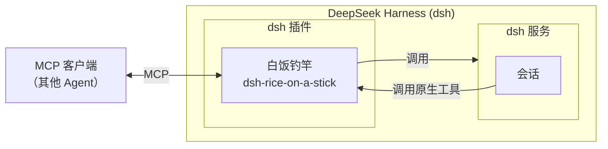

<div align="center">
  

# 白饭钓竿

中文 | [English](README.en.md)

[](https://github.com/deepseek-ai/deepseek-harness)
[](https://github.com/Leawind/dsh-rice-on-a-stick/releases)
[](https://github.com/Leawind/dsh-rice-on-a-stick/commits/main)

一个将控制 [DeepSeek Harness](https://github.com/deepseek-ai/deepseek-harness) 的能力暴露为 MCP 和内置工具的 dsh 插件。

</div>



## 特性

- **操作会话**：新建、发送、排队、分叉、归档与恢复、切换模型等。侧栏页的“模型”标签页可以只允许特定模型，使客户端只能使用勾选的模型；也可以在那里为模型和模型提供商各写一段简介，简介随 `model_list` / `dsh://models` 提供给调用方
- **像普通网页用户一样回答**：插件作为 Web answer client 接收审批与 `ask_user_question`；原生卡片照常显示，人和 agent 先答者赢。轮询可发现待回答项，`approval_answer` / `question_answer` 直接提交
- **dsh 端点直通**：dsh 长尾能力的低策展覆盖。凭据写入/插件安装/连接信任等危险端点没有硬闸，与普通端点走相同的白名单/停泊审批两条通路，但在面板单列成独立的危险清单并标注；机制见 `CONTRIBUTING.md` 与 `docs/endpoint-passthrough.zh.md`
- **dsh 自己也能用**：这些能力同时注册为 dsh 的内部工具，dsh 会话可直接调用。不需要时可以在设置里关闭。
- **安全默认**：默认只监听本机，可配置访问令牌。

> [!WARNING]
>
> - 未启用认证时，任何能访问对应端口的本机进程都可以驱动 dsh
> - 这个插件会对调用者暴露本机代码执行能力，默认只监听 `127.0.0.1`
> - dsh 内部的自用工具启用后，本 dsh 实例的任何会话都能调用，因为它们不经 HTTP、也与令牌无关

## 环境要求

- dsh `0.2.1-rc.2` 及以上。图形界面（侧栏"白饭钓竿"页）和完整的会话功能需要 web 或 desktop 版 dsh
- MCP 客户端需支持 Streamable HTTP，只支持 stdio 的客户端需要自行桥接

## 安装

通过 npm 安装：

```sh
dsh plugin --profile web add dsh-rice-on-a-stick
```

通过源码安装并实现实时更新：

```sh
git clone https://github.com/Leawind/dsh-rice-on-a-stick
cd dsh-rice-on-a-stick
npm install
npm run build
dsh plugin --profile web add link:.

# 监听源码变动并实时构建
npm run dev
```

卸载：

```sh
dsh plugin --profile web remove dsh-rice-on-a-stick
```

### 接入 MCP 客户端

MCP server 默认监听 `http://127.0.0.1:5642/mcp`，传输方式为 Streamable HTTP；在设置中开启认证后，需要配置 Bearer 凭证。

## 配置

所有配置都可在 dsh 侧栏的"白饭钓竿"页（安全标签）里改；MCP 连接空闲上限在连接标签。profile 目录下的 `cordis.patch.yml`全部字段、默认值与说明见 [src/core/config.ts](src/core/config.ts)：

## 工具一览

下表按域列出本插件注册的全部 MCP 工具。

### 目录与状态

| 工具              | 用途                                                                                                        |
| ----------------- | ----------------------------------------------------------------------------------------------------------- |
| `echo`            | 回显输入，用于验证 MCP 连接                                                                                 |
| `dsh_get_started` | dsh 入门指南：概念表、工作流配方与错误→替代路径，`section` 可只取一节                                       |
| `dsh_list_tools`  | 列出宿主的全局工具注册表（模型工具在会话/预设作用域内，该表通常为空）                                       |
| `dsh_status`      | 只读部署状态：版本、监听、配置摘要、订阅统计与已连接客户端，与设置面板同源                                  |
| `workspace_list`  | 列出已注册工作区（id、路径、归属会话）                                                                      |
| `model_list`      | 列出可路由的提供商、模型 id、推理档、预设花名册与宿主当前缺省选择                                           |
| `permission_list` | 列出宿主的权限预设（沙箱 + 审批组合），是 `session_create.permission` / `session_set_permission` 的取值来源 |
| `subagent_list`   | 只读读取会话的原生子代理目录，`recursive=true` 递归列出后代                                                 |

### 会话操作

| 工具                     | 用途                                                                                        |
| ------------------------ | ------------------------------------------------------------------------------------------- |
| `session_create`         | 新建空白会话，`cwd`、provider/model、preset 全部显式给出，返回 `sessionId`                  |
| `session_set_permission` | 切换会话的权限预设（界面 `/permission` 的服务端语义），可修正旋钮级改动造成的 `custom` 组合 |
| `session_prompt`         | 向会话发消息并等待本轮结束，返回结构化结果；默认在等待审批/提问时提前返回                   |
| `session_submit`         | 异步投递任务，立即返回 `requestId`，不等待本轮结束                                          |
| `session_poll`           | 批量观察会话状态，`waitMs` 最多等 30 秒，返回状态、排队数、待回答项与最后一条消息           |
| `session_result`         | 按 `requestId` 取回结构化结果，省略则取该会话最近一次请求                                   |
| `session_cancel`         | 停止会话当前 turn，保留尚未开始的排队消息                                                   |
| `session_queue`          | 管理会话的排队消息：列出、改写、删除，或用 `action="steer"` 提升为插话                      |
| `session_select_model`   | 会话内切换模型，下一个步生效且历史保留（开启“只允许特定模型”时目标须在清单内）              |
| `session_rename`         | 重命名会话，走宿主 `sessionTitle` 服务（用户改名会钉住自动标题）                            |
| `session_fork`           | 分叉会话：从源会话事件的前缀派生新会话，继承 cwd、预设与当前模型                            |
| `session_command`        | 列出或执行会话可用的斜杠命令，不发给模型也不产生 turn                                       |
| `session_archive`        | 归档会话（界面唯一的“删除”，软标记）；活动会话需 `stopActivity=true`                        |
| `session_unarchive`      | 恢复已归档会话，幂等；未归档的会话如实回报 `wasArchived: false`                             |

### 会话读取

| 工具               | 用途                                                                       |
| ------------------ | -------------------------------------------------------------------------- |
| `session_list`     | 列出会话元信息（标题、cwd、预设、权限预设、当前模型），默认隐藏已归档      |
| `session_history`  | 读取会话对话纪要，默认 user + assistant，可分页并用 `roles` 展开工具调用   |
| `session_meta`     | 读取单个会话的元信息与运行状态：轮/步计数、上下文占用等                    |
| `session_overview` | 一次调用给出界面级概览：标题、权限、模型、进行中状态、上下文占用与近期摘要 |
| `session_search`   | 按字面短语搜索会话内容（同界面搜索框），默认排除已归档                     |

### 审批

| 工具              | 用途                                                            |
| ----------------- | --------------------------------------------------------------- |
| `approval_list`   | 列出若干会话中待处理的审批（含 `answerable` 与 `policy`），只读 |
| `approval_answer` | 回答本插件持有的审批：`allow` 一次性放行，`reject` 拒绝         |
| `approval_policy` | 读取或切换会话的审批策略旋钮（`ask` / `never`）                 |

### 问题

| 工具              | 用途                                                           |
| ----------------- | -------------------------------------------------------------- |
| `question_list`   | 列出若干会话中待回答的 `ask_user_question`（含问题批次），只读 |
| `question_answer` | 回答本插件持有的提问批次，子 turn 带着答案继续                 |

### 附件

| 工具              | 用途                                                                                        |
| ----------------- | ------------------------------------------------------------------------------------------- |
| `attachment_read` | 按引用读取会话中的图片附件：默认返回元数据与宿主本地路径，`inline=true` 时回 MCP 图片内容块 |

### 宿主端点直通

两工具覆盖 dsh 的长尾 Remote 端点，端点数量随宿主而变化，因此端点本身不逐条列出（机制见 [docs/endpoint-passthrough.zh.md](docs/endpoint-passthrough.zh.md)）。

| 工具                | 用途                                                                                                                                                                                                            |
| ------------------- | --------------------------------------------------------------------------------------------------------------------------------------------------------------------------------------------------------------- |
| `endpoint_describe` | 搜索优先地发现 dsh Remote 端点：`query` 关键词搜索并可按 `namespace` 收窄、无参给命名空间索引、`namespace` 列单域方法、`endpoint` 取精确契约；条目标注 `readOnly` / `allowed` / `writable` / `approvalRequired` |
| `endpoint_call`     | 按 `endpoint_describe` 给出的端点调用，`args` 为具名线参；白名单内直接执行，其余非流式端点挂起到人工审批，拒绝、超时与调用方断开一律失败且不执行                                                                |

## 发送行为：排队 / 插话

`session_prompt` 与 `session_submit` 的投递方式按调用选择，与界面偏好无关。目标会话正在跑 turn 时必须显式指定 `mode`：

- `mode: "queue"`（排队）：当前 turn 结束后作为新一轮投递
- `mode: "steer"`（插话）：在当前 turn 的下一个步边界注入并延长本轮，不打断正在执行的步
- 省略 `mode` 只在会话空闲时成立，此时 queue 与 steer 等价、引擎按 queue 处理；会话运行中省略会直接失败（`MODE_REQUIRED`），插件不会替调用方猜测
- 若已有排队消息，可用 `session_queue` 的 `action: "steer"` 将其提升为插话

## 感谢

初始源码复制自 [`chushixixin/dsh-harness-mcp-server`](https://github.com/chushixixin/dsh-harness-mcp-server)（MIT，感谢 @chushixixin）。
