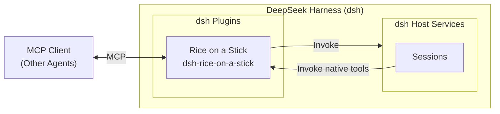

<div align="center">
  

# Rice on a Stick

[中文](README.zh.md) | English

[](https://github.com/deepseek-ai/deepseek-harness)
[](LICENSE)

This plugin exposes various features of [DeepSeek Harness](https://github.com/deepseek-ai/deepseek-harness) as an MCP server, allowing other agents to create and manipulate dsh sessions.  
The same set of tools is registered by default as native dsh tools, so dsh's own sessions can operate on themselves directly.

</div>



## Features

-   **Operate real sessions** — create, send, queue, fork, archive and restore, switch models, and more.
    -   Creating a new session requires the calling agent to explicitly specify a model and preset.
    -   When continuing an existing session, the session's original model is retained.
    -   A model allowlist can be manually configured so that clients can only use models on the list.
-   **Synchronous or asynchronous** — the calling agent can wait for results in place, or submit and come back later; a wait timeout does not interrupt tasks running in dsh, and tasks can be stopped at any time.
-   **Approval takeover** — approval requests raised in sessions created by the plugin are answered by the calling agent by default, and are no longer shown again in the UI; this can also be changed to UI-first answering, or display-only without takeover.
-   **dsh can use it too** — these capabilities are also registered as internal dsh tools, callable directly from dsh sessions; they can be disabled in settings if not needed.
-   **Secure by default** — listens only on localhost by default, with an optional access token.

> [!WARNING]
>
> -   When authentication is not enabled, any local process that can reach the corresponding port can drive dsh.
> -   This plugin exposes local code execution capability to callers, and listens only on `127.0.0.1` by default.
> -   Once the internal self-use tools are enabled, any session of this dsh instance can call them, because they do not go through HTTP and are unrelated to the token.

## Requirements

dsh `0.2.1-rc.2` or later. The settings panel and full session functionality require the web or desktop version of dsh; MCP clients must support Streamable HTTP, and clients that only support stdio need to bridge it themselves.

## Installation

Install via npm:

```sh
dsh plugin --profile web add dsh-rice-on-a-stick
```

Install from source with live updates:


```sh
git clone https://github.com/Leawind/dsh-rice-on-a-stick
cd dsh-rice-on-a-stick
npm install
npm build
dsh plugin --profile web add link:.

# Watch source changes and rebuild live
npm run dev
```

Uninstall:

```sh
dsh plugin --profile web remove dsh-rice-on-a-stick
```

### Connecting an MCP Client

The MCP server listens on `http://127.0.0.1:8090/mcp` by default, using Streamable HTTP transport; after enabling authentication in settings, Bearer credentials must be configured.

## Configuration

All configuration can be changed in the graphical settings panel, taking effect on save. You can also edit `cordis.patch.yml` in the profile directory directly (see [src/core/config.ts](src/core/config.ts) for all fields, defaults, and descriptions):

```yaml
- id: dsh-rice-on-a-stick
  config:
      http: true
      port: 8090
      host: 127.0.0.1
      # authToken: 'your-secret-token'
```

## Acknowledgements

The initial source code was copied from [`chushixixin/dsh-harness-mcp-server`](https://github.com/chushixixin/dsh-harness-mcp-server) (MIT, thanks to @chushixixin), and is now an independent project.
